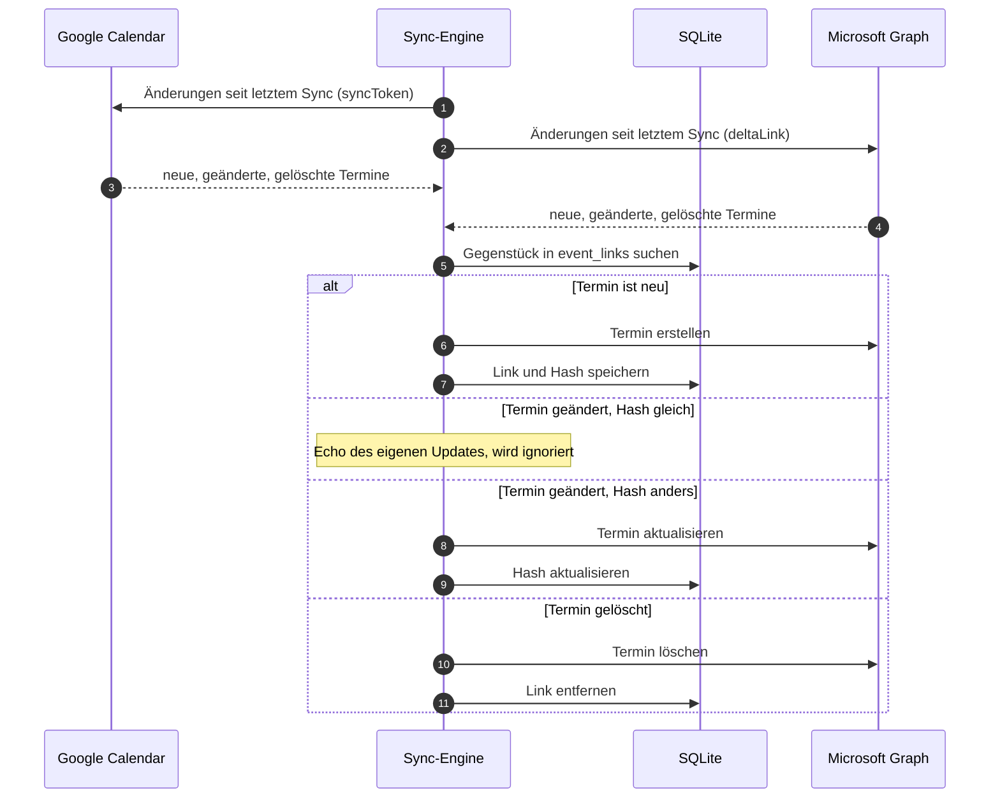
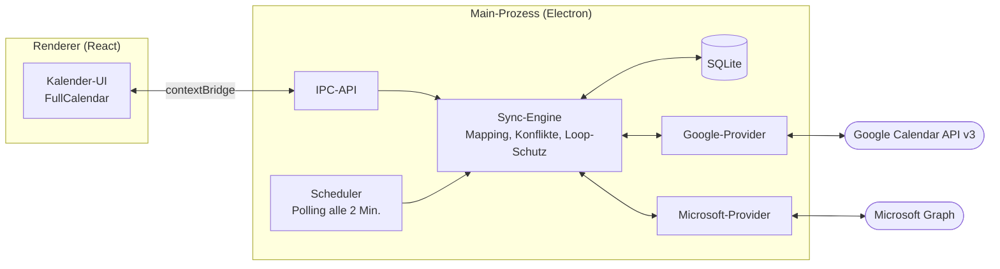

<div align="center">

# 📅 easy-Calender

### Google Kalender ↔ Outlook – endlich synchron.

Eine Desktop-App für Windows, die Google- und Outlook-Kalender verbindet,<br>
alle Termine **bidirektional** synchronisiert und sie in einer einzigen Ansicht zeigt.

<br>


<br>

[Features](#-features) ·
[So funktioniert der Sync](#-so-funktioniert-der-sync) ·
[Architektur](#-architektur) ·
[Roadmap](#-roadmap) ·
[Einrichtung](#-einrichtung) ·
[Dokumentation](#-dokumentation)

</div>

---

> [!NOTE]
> **Projektstatus:** Das Projekt steht ganz am Anfang. Der Plan und die Dokumentation sind da, Code gibt es noch keinen.
> Den aktuellen Stand findest du immer im [Arbeitsjournal](docs/JOURNAL.md) und in der [Roadmap](#-roadmap).

## 💡 Worum geht es?

Wer einen privaten Google-Kalender und dazu Outlook-Kalender von Schule oder Firma hat, pflegt Termine oft doppelt.
**easy-Calender** nimmt einem das ab:

- Ein Termin, der in Google erstellt wird, erscheint in Outlook, und umgekehrt.
- Ändern und Löschen wird genauso gespiegelt.
- Alle Kalender aller Konten sind in einer kombinierten Ansicht sichtbar.
- Termine lassen sich direkt in der App erstellen.

## ✨ Features

| | Feature | Beschreibung |
|:-:|---|---|
| 🔄 | **Bidirektionaler Sync** | Erstellen, Ändern und Löschen wird in beide Richtungen übertragen. |
| 👥 | **Beliebig viele Konten** | Privates Google-Konto, privates Outlook-Konto sowie Schul- und Firmenkonten von Microsoft. |
| 🗓️ | **Kombinierte Ansicht** | Monats-, Wochen- und Tagesansicht mit allen Kalendern zusammen. |
| ✏️ | **Termine in der App** | Erstellen, bearbeiten und löschen, direkt beim jeweiligen Anbieter. |
| 🔗 | **Kalender-Paare** | Du bestimmst, welche Kalender miteinander gekoppelt sind. Mehrere Paare sind möglich. |
| 🔁 | **Wiederkehrende Termine** | Serien inklusive verschobener oder abgesagter Einzeltermine. |
| 🛡️ | **Loop-Schutz** | Die App erkennt das Echo ihrer eigenen Änderungen, es gibt kein Ping-Pong. |
| ⚖️ | **Konfliktlösung** | Wurden beide Seiten geändert, gewinnt die neuere Änderung. Das steht danach im Sync-Log. |
| 🔐 | **Sichere Tokens** | Verschlüsselt gespeichert über Electron `safeStorage` (Windows DPAPI). |
| 📌 | **Läuft im Tray** | Der Sync läuft weiter, auch wenn das Fenster minimiert ist. |

## 🔄 So funktioniert der Sync

Der Sync läuft pro Kalender-Paar, alle 2 Minuten, beim Fokussieren des Fensters oder manuell.



Das Diagramm zeigt die Richtung Google → Outlook. Die Gegenrichtung läuft identisch.

<details>
<summary><b>Was passiert bei Konflikten und Fehlern?</b></summary>

<br>

| Situation | Verhalten |
|---|---|
| Beide Seiten seit dem letzten Sync geändert | Die neuere Änderung (`updated` / `lastModifiedDateTime`) gewinnt, Eintrag im Sync-Log |
| `401` Token abgelaufen | Token erneuern und wiederholen |
| `410` `syncToken` abgelaufen | Vollabgleich |
| `429` zu viele Anfragen | Backoff, später erneut versuchen |
| Lokale Datenbank verloren | Gespiegelte Termine werden über eine ID-Markierung im Termin wiedererkannt |
| RRULE, die Graph nicht abbilden kann | Wird als Einzeltermine gespiegelt, Warnung im Log |

</details>

## 🧱 Architektur



<details>
<summary><b>Geplante Projektstruktur</b></summary>

```
src/
  main/
    index.ts                 Electron-Start, Fenster, Tray, IPC-Registrierung
    db/schema.ts, db.ts      SQLite-Schema + Zugriff
    auth/googleAuth.ts       Loopback-OAuth, Token-Refresh
    auth/microsoftAuth.ts    MSAL interaktiv + silent, Token-Cache in safeStorage
    providers/types.ts       CalendarProvider-Interface + normalisiertes Event-Modell
    providers/google.ts      list/delta (syncToken), create/update/delete
    providers/microsoft.ts   list/delta (Graph delta), create/update/delete
    sync/engine.ts           Sync-Zyklus, Mapping, Konfliktlösung, Loop-Schutz
    sync/mapper.ts           Google ↔ normalisiert ↔ Graph (inkl. Recurrence/RRULE)
    sync/scheduler.ts        Polling (alle 2 Min. + bei Fokus + manuell)
    ipc.ts                   API für den Renderer
  preload/index.ts           contextBridge (sichere, schmale API)
  renderer/
    App.tsx, CalendarView.tsx, EventDialog.tsx, AccountsPage.tsx, SyncSettings.tsx
```

</details>

Die Details zu Datenmodell, Event-Modell und Sync-Algorithmus stehen in [docs/ARCHITEKTUR.md](docs/ARCHITEKTUR.md).

## 🧰 Tech-Stack

| Bereich | Technologie |
|---|---|
| App-Gerüst | Electron + Vite + React + TypeScript (Vorlage `electron-vite`) |
| Kalender-UI | FullCalendar (`@fullcalendar/react`) |
| Lokale Datenbank | `better-sqlite3` im Main-Prozess |
| Google | `googleapis` (Calendar API v3), OAuth 2.0 «Desktop app» mit Loopback-Redirect + PKCE |
| Microsoft | `@azure/msal-node` (Authority `common`) + `@microsoft/microsoft-graph-client` |
| Token-Speicher | Electron `safeStorage` (Windows DPAPI) |
| Tests | Vitest |
| Installer | electron-builder |

## 🚀 Roadmap

- [x] **Etappe 0:** Plan, README und Dokumentation
- [ ] **Etappe 1:** Grundgerüst (Projekt, SQLite, IPC, FullCalendar-UI mit lokalen Dummy-Daten)
- [ ] **Etappe 2:** Google-Login, Kalender lesen und anzeigen
- [ ] **Etappe 3:** Microsoft-Login, Kalender lesen und anzeigen
- [ ] **Etappe 4:** Termine in der App erstellen, bearbeiten und löschen
- [ ] **Etappe 5:** Sync-Engine für Einzeltermine (Mapping, Loop-Schutz, Konflikte, Löschungen)
- [ ] **Etappe 6:** Wiederkehrende Termine und Ausnahmen
- [ ] **Etappe 7:** Feinschliff (Kalender-Paare auswählen, Sync-Log, Tray-Icon, Autostart, Fehleranzeigen)

## 🔑 Einrichtung

Damit die App auf deine Kalender zugreifen darf, braucht es einmalig zwei kostenlose Registrierungen:

| Anbieter | Was | Ergebnis |
|---|---|---|
| **Google Cloud Console** | Projekt, Calendar API, OAuth-Client «Desktop app», dich als Testnutzer eintragen | Client-ID + Secret in `.env` |
| **Azure Portal** | App-Registrierung als öffentlicher Client mit `Calendars.ReadWrite` + `offline_access` | Client-ID in `.env` |

Die Schritt-für-Schritt-Anleitung steht in [docs/SETUP.md](docs/SETUP.md).

> [!WARNING]
> Bei Schul- oder Firmenkonten kann die Organisation die Zustimmung für Dritt-Apps blockieren.
> Dann funktionieren nur private Microsoft-Konten, bis ein Admin die App freigibt.

### Entwicklung

> Diese Befehle funktionieren ab Etappe 1, sobald das Grundgerüst steht.

```bash
npm install     # Abhängigkeiten installieren
npm run dev     # App im Entwicklungsmodus starten
npm test        # Unit-Tests (Vitest)
npm run build   # Windows-Installer erzeugen (electron-builder)
```

## 🚧 Bewusste Grenzen (v1)

- **Polling statt Push:** Webhooks bräuchten einen öffentlich erreichbaren Server. Der Sync läuft deshalb nur, solange die App offen ist. Im Tray minimiert reicht.
- **Keine Teilnehmer und Einladungen:** Sie werden nicht gespiegelt, um ungewollte Einladungsmails zu vermeiden. Gespiegelt werden Titel, Zeit, Ort, Beschreibung und Wiederholung.

## 📚 Dokumentation

| Dokument | Inhalt |
|---|---|
| 📓 [Arbeitsjournal](docs/JOURNAL.md) | Laufendes Protokoll: was wann gemacht wurde und was als Nächstes kommt |
| 🏗️ [Architektur](docs/ARCHITEKTUR.md) | Aufbau, Datenmodell, Event-Modell, Sync-Algorithmus |
| 🧭 [Entscheidungen](docs/ENTSCHEIDUNGEN.md) | Wichtige technische Entscheidungen mit Begründung |
| 🔑 [Setup](docs/SETUP.md) | Google Cloud und Azure einrichten, `.env` |
| 🧪 [Testplan](docs/TESTPLAN.md) | Unit-Tests und manuelle Testfälle mit Status |

---

<div align="center">
<sub>Gebaut von Namir · Electron, React und viel Kalender-Frust als Motivation</sub>
</div>
