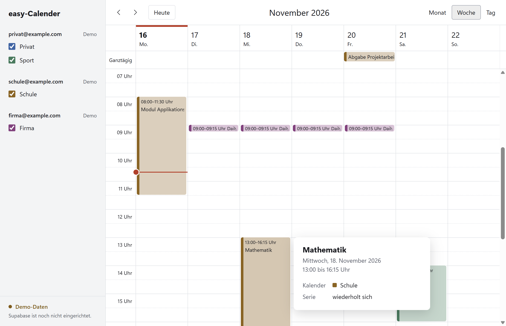
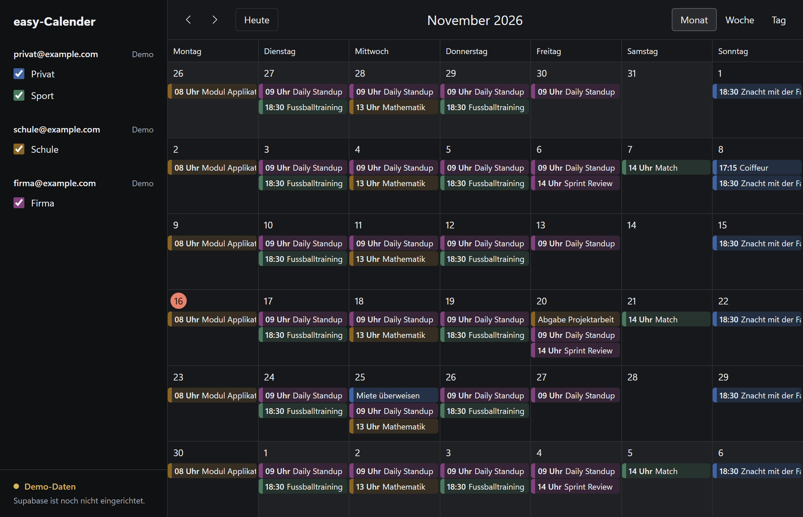
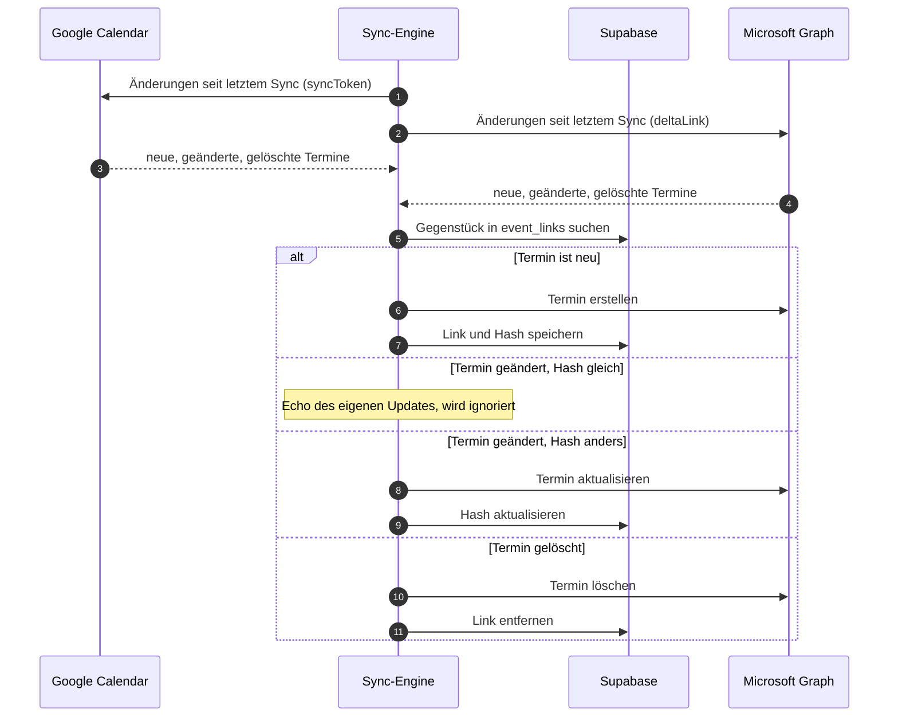
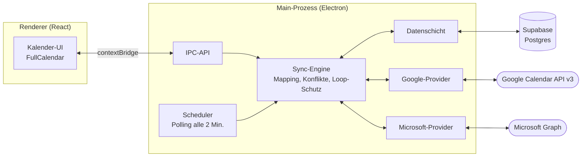

<div align="center">

# 📅 easy-Calender

### Google Kalender ↔ Outlook – endlich synchron.

Eine Desktop-App für Windows, die Google- und Outlook-Kalender verbindet,<br>
alle Termine **bidirektional** synchronisiert und sie in einer einzigen Ansicht zeigt.

<br>


<br>

[Features](#-features) ·
[So funktioniert der Sync](#-so-funktioniert-der-sync) ·
[Architektur](#-architektur) ·
[Roadmap](#-roadmap) ·
[Einrichtung](#-einrichtung) ·
[Dokumentation](#-dokumentation)

<br>



</div>

---

> [!NOTE]
> **Projektstatus:** Das Grundgerüst steht (Etappe 1), die Daten liegen in Supabase. Der Google-Login (Etappe 2) ist geschrieben, aber noch nicht mit einem echten Konto geprüft.
> Microsoft und der Sync folgen in den nächsten Etappen. Den aktuellen Stand findest du im [Arbeitsjournal](docs/JOURNAL.md).

## 💡 Worum geht es?

Wer einen privaten Google-Kalender und dazu Outlook-Kalender von Schule oder Firma hat, pflegt Termine oft doppelt.
**easy-Calender** nimmt einem das ab:

- Ein Termin, der in Google erstellt wird, erscheint in Outlook, und umgekehrt.
- Ändern und Löschen wird genauso gespiegelt.
- Alle Kalender aller Konten sind in einer kombinierten Ansicht sichtbar.
- Termine lassen sich direkt in der App erstellen.

## ✨ Features

Das ist das Ziel der App. Was davon schon gebaut ist, zeigt die [Roadmap](#-roadmap).

|     | Feature                    | Beschreibung                                                                               |
| :-: | -------------------------- | ------------------------------------------------------------------------------------------ |
| 🔄  | **Bidirektionaler Sync**   | Erstellen, Ändern und Löschen wird in beide Richtungen übertragen.                         |
| 👥  | **Beliebig viele Konten**  | Privates Google-Konto, privates Outlook-Konto sowie Schul- und Firmenkonten von Microsoft. |
| 🗓️  | **Kombinierte Ansicht**    | Monats-, Wochen- und Tagesansicht mit allen Kalendern zusammen.                            |
| ✏️  | **Termine in der App**     | Erstellen, bearbeiten und löschen, direkt beim jeweiligen Anbieter.                        |
| 🔗  | **Kalender-Paare**         | Du bestimmst, welche Kalender miteinander gekoppelt sind. Mehrere Paare sind möglich.      |
| 🔁  | **Wiederkehrende Termine** | Serien inklusive verschobener oder abgesagter Einzeltermine.                               |
| 🛡️  | **Loop-Schutz**            | Die App erkennt das Echo ihrer eigenen Änderungen, es gibt kein Ping-Pong.                 |
| ⚖️  | **Konfliktlösung**         | Wurden beide Seiten geändert, gewinnt die neuere Änderung. Das steht danach im Sync-Log.   |
| 🔐  | **Sichere Tokens**         | Verschlüsselt gespeichert über Electron `safeStorage` (Windows DPAPI).                     |
| 📌  | **Läuft im Tray**          | Der Sync läuft weiter, auch wenn das Fenster minimiert ist.                                |

<div align="center">

</div>

## 🔄 So funktioniert der Sync

Der Sync läuft pro Kalender-Paar, alle 2 Minuten, beim Fokussieren des Fensters oder manuell.



Das Diagramm zeigt die Richtung Google → Outlook. Die Gegenrichtung läuft identisch.

<details>
<summary><b>Was passiert bei Konflikten und Fehlern?</b></summary>

<br>

| Situation                                   | Verhalten                                                                             |
| ------------------------------------------- | ------------------------------------------------------------------------------------- |
| Beide Seiten seit dem letzten Sync geändert | Die neuere Änderung (`updated` / `lastModifiedDateTime`) gewinnt, Eintrag im Sync-Log |
| `401` Token abgelaufen                      | Token erneuern und wiederholen                                                        |
| `410` `syncToken` abgelaufen                | Vollabgleich                                                                          |
| `429` zu viele Anfragen                     | Backoff, später erneut versuchen                                                      |
| Datenbank verloren                          | Gespiegelte Termine werden über eine ID-Markierung im Termin wiedererkannt            |
| RRULE, die Graph nicht abbilden kann        | Wird als Einzeltermine gespiegelt, Warnung im Log                                     |

</details>

## 🧱 Architektur



Sync-Engine, Scheduler und die beiden Provider sind geplant. Gebaut sind bis jetzt Oberfläche, IPC-API, Datenschicht und ein Demo-Provider.

<details>
<summary><b>Projektstruktur</b></summary>

```
src/
  shared/types.ts            Typen für Main, Preload und Renderer (Event-Modell, API)
  main/
    index.ts                 Electron-Start, Fenster, IPC-Registrierung
    config.ts                liest und prüft die Supabase-Zugangsdaten
    dateRange.ts             prüft Zeiträume, die vom Renderer kommen
    ipc.ts                   API für den Renderer
    db/                      Datenschicht: Supabase oder Arbeitsspeicher
    providers/types.ts       CalendarProvider-Interface
    providers/demo.ts        Demo-Termine für Etappe 1
  preload/index.ts           contextBridge (sichere, schmale API)
  renderer/src/
    App.tsx
    components/              CalendarView, CalendarList, EventDetails, StatusBadge
supabase/migrations/         Datenbankschema mit Zugriffsregeln (RLS)
```

Seit Etappe 2 dazu: `accounts.ts` (Konten verbinden und entfernen), `auth/` (Google-Login), `providers/google.ts`, `secureStorage.ts` (verschlüsselte Ablage). Geplant und noch nicht vorhanden: Microsoft-Login, `providers/microsoft.ts`, `sync/` (Engine, Mapper, Scheduler).

</details>

Die Details zu Datenmodell, Event-Modell und Sync-Algorithmus stehen in [docs/ARCHITEKTUR.md](docs/ARCHITEKTUR.md).

## 🧰 Tech-Stack

| Bereich        | Technologie                                                                                    |
| -------------- | ---------------------------------------------------------------------------------------------- |
| App-Gerüst     | Electron + Vite + React + TypeScript (Vorlage `electron-vite`)                                 |
| Kalender-UI    | FullCalendar 7 (`@fullcalendar/react`)                                                         |
| Datenbank      | Supabase (Postgres) über `@supabase/supabase-js`, Zugriff nur aus dem Main-Prozess             |
| Google         | `@googleapis/calendar` (Calendar API v3), OAuth 2.0 «Desktop app» mit Loopback-Redirect + PKCE |
| Microsoft      | `@azure/msal-node` (Authority `common`) + `@microsoft/microsoft-graph-client`                  |
| Token-Speicher | Electron `safeStorage` (Windows DPAPI)                                                         |
| Tests          | Vitest                                                                                         |
| Installer      | electron-builder                                                                               |

## 🚀 Roadmap

- [x] **Etappe 0:** Plan, README und Dokumentation
- [x] **Etappe 1:** Grundgerüst (Projekt, Supabase-Datenschicht, IPC, FullCalendar-UI mit Demo-Daten)
- [ ] **Etappe 2:** Google-Login, Kalender lesen und anzeigen _(Code fertig, Prüfung mit echtem Konto offen)_
- [ ] **Etappe 3:** Microsoft-Login, Kalender lesen und anzeigen
- [ ] **Etappe 4:** Termine in der App erstellen, bearbeiten und löschen
- [ ] **Etappe 5:** Sync-Engine für Einzeltermine (Mapping, Loop-Schutz, Konflikte, Löschungen)
- [ ] **Etappe 6:** Wiederkehrende Termine und Ausnahmen
- [ ] **Etappe 7:** Feinschliff (Kalender-Paare auswählen, Sync-Log, Tray-Icon, Autostart, Fehleranzeigen)

## 🔑 Einrichtung

### Starten

```bash
npm install     # Abhängigkeiten installieren
npm run dev     # App im Entwicklungsmodus starten
npm test        # Unit-Tests (Vitest)
npm run build   # Windows-Installer erzeugen (landet in dist/)
```

Ohne `.env` startet die App mit Demo-Daten im Arbeitsspeicher. Mit Supabase-Zugangsdaten liegen Konten und Kalender in der Datenbank.

### Dienste registrieren

Für den echten Betrieb braucht es einmalig drei kostenlose Registrierungen:

| Dienst                   | Was                                                                                    | Ab Etappe | Ergebnis in `.env`    |
| ------------------------ | -------------------------------------------------------------------------------------- | :-------: | --------------------- |
| **Supabase**             | Projekt, Schema einspielen, «Anonymous sign-ins» aktivieren                            |     1     | URL + Publishable Key |
| **Google Cloud Console** | Projekt, Calendar API, OAuth-Client «Desktop app», dich als Testnutzer eintragen       |     2     | Client-ID + Secret    |
| **Azure Portal**         | App-Registrierung als öffentlicher Client mit `Calendars.ReadWrite` + `offline_access` |     3     | Client-ID             |

Die Schritt-für-Schritt-Anleitung steht in [docs/SETUP.md](docs/SETUP.md).

> [!WARNING]
> Bei Schul- oder Firmenkonten kann die Organisation die Zustimmung für Dritt-Apps blockieren.
> Dann funktionieren nur private Microsoft-Konten, bis ein Admin die App freigibt.

## 🚧 Bewusste Grenzen (v1)

- **Polling statt Push:** Webhooks bräuchten einen öffentlich erreichbaren Server. Der Sync läuft deshalb nur, solange die App offen ist. Im Tray minimiert reicht.
- **Keine Teilnehmer und Einladungen:** Sie werden nicht gespiegelt, um ungewollte Einladungsmails zu vermeiden. Gespiegelt werden Titel, Zeit, Ort, Beschreibung und Wiederholung.
- **Datenbank in der Cloud:** Der Sync-Zustand liegt in Supabase. Die App braucht dafür Internet, was der Sync ohnehin voraussetzt. Tokens von Google und Microsoft bleiben auf dem Gerät.

## 📚 Dokumentation

| Dokument                                    | Inhalt                                                                 |
| ------------------------------------------- | ---------------------------------------------------------------------- |
| 📓 [Arbeitsjournal](docs/JOURNAL.md)        | Laufendes Protokoll: was wann gemacht wurde und was als Nächstes kommt |
| 🏗️ [Architektur](docs/ARCHITEKTUR.md)       | Aufbau, Datenmodell, Event-Modell, Sync-Algorithmus                    |
| 🧭 [Entscheidungen](docs/ENTSCHEIDUNGEN.md) | Wichtige technische Entscheidungen mit Begründung                      |
| 🎨 [Design](docs/DESIGN.md)                 | Gestaltungsregeln der Oberfläche: Farben, Schrift, Formen              |
| 🔑 [Setup](docs/SETUP.md)                   | Supabase, Google Cloud und Azure einrichten, `.env`                    |
| 🧪 [Testplan](docs/TESTPLAN.md)             | Unit-Tests und manuelle Testfälle mit Status                           |

---

<div align="center">
<sub>Gebaut von Namir · Electron, React und viel Kalender-Frust als Motivation</sub>
</div>
