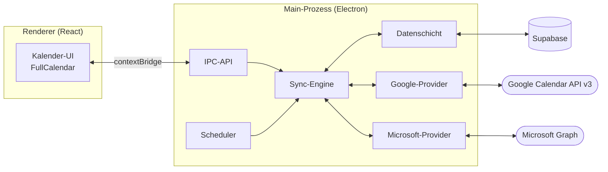
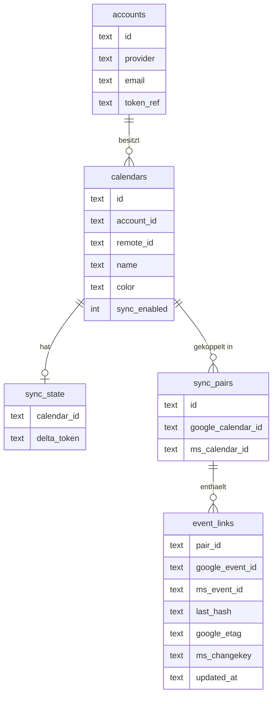

# 🏗️ Architektur

Dieses Dokument beschreibt den geplanten Aufbau der App. Es wird mit jeder Etappe an den echten Stand angepasst.

> **Stand:** Version 0.9.0. Alle Teile sind gebaut. Mit echten Konten geprüft sind sie noch nicht.

## Überblick

Die App ist eine Electron-Anwendung mit drei Teilen:

| Teil             | Aufgabe                                                                      |
| ---------------- | ---------------------------------------------------------------------------- |
| **Main-Prozess** | Fenster, Tray, Datenschicht, Anmeldung bei Google und Microsoft, Sync-Engine |
| **Preload**      | Schmale, sichere Brücke (`contextBridge`) zwischen Renderer und Main-Prozess |
| **Renderer**     | React-Oberfläche mit FullCalendar, Dialogen und Einstellungen                |

Der Renderer spricht nie direkt mit Google oder Microsoft. Alle Zugriffe laufen über die IPC-API im Main-Prozess, dort liegen auch die Tokens.

## Projektstruktur

Die aktuelle Struktur steht im [README](../README.md#-architektur). Geplant und noch nicht vorhanden sind der Microsoft-Login, `providers/microsoft.ts` und `sync/` (Engine, Mapper, Scheduler).

## Normalisiertes Event-Modell

Beide Anbieter werden auf ein gemeinsames Modell abgebildet:

| Feld               | Bedeutung                                                               |
| ------------------ | ----------------------------------------------------------------------- |
| `title`            | Titel des Termins                                                       |
| `description`      | Beschreibung                                                            |
| `location`         | Ort                                                                     |
| `start`, `end`     | Beginn und Ende. Ganztägig als Datum, sonst als Zeitpunkt nach ISO 8601 |
| `allDay`           | Ganztägiger Termin                                                      |
| `timeZone`         | Zeitzone                                                                |
| `recurrence`       | Wiederholung als RRULE                                                  |
| `attendees?`       | Teilnehmer (optional, wird in v1 nicht gespiegelt)                      |
| `status`           | Status, z. B. bestätigt oder abgesagt                                   |
| `showAs?`          | «Anzeigen als»: frei, mit Vorbehalt, gebucht, abwesend, woanders tätig  |
| `private?`         | Privat                                                                  |
| `reminderMinutes?` | Erinnerung in Minuten vor Beginn, `null` heisst keine                   |
| `categories?`      | Namen der Kategorien                                                    |

Die vier Felder mit `?` zeigt und schreibt die App, abgeglichen werden sie nicht (E-019). Google kennt nur «frei» und «gebucht»: Die genaue Angabe und die Kategorien stehen dort in `extendedProperties.private` (`easyShowAs`, `easyCategories`). Ein einzelnes Vorkommen einer Serie trägt zusätzlich `seriesId`, die ID der ganzen Serie. So lassen sich in der App «Serie bearbeiten» und «Serie löschen» anbieten.

Gesynct wird nur diese definierte Teilmenge an Feldern. So geht nichts verloren, nur weil ein Feld beim anderen Anbieter kein Gegenstück hat.

## Datenbank

Die Daten liegen in **Supabase** (Postgres). Das Schema steht in [`supabase/migrations`](../supabase/migrations). Nur der Main-Prozess spricht mit Supabase, über die Datenschicht in `src/main/db`. Sie hat zwei Umsetzungen mit derselben Schnittstelle:

- `SupabaseStore`: der Normalfall, sobald die Zugangsdaten in `.env` stehen
- `MemoryStore`: Demo-Daten im Arbeitsspeicher, solange Supabase nicht eingerichtet oder nicht erreichbar ist, und für Tests

Jede Zeile gehört einem Supabase-Benutzer (`user_id`). Row Level Security sorgt dafür, dass jeder nur seine eigenen Zeilen sieht. Die App meldet sich beim ersten Start anonym an. Diese Sitzung liegt verschlüsselt im Electron `safeStorage`.

Zusätzlich zum Plan haben alle Tabellen die Spalte `user_id`, und `calendars` hat `visible` (ob der Kalender in der Ansicht gezeigt wird).

| Tabelle       | Zweck                                                                                          |
| ------------- | ---------------------------------------------------------------------------------------------- |
| `accounts`    | Verbundene Konten mit Anbieter, E-Mail und Verweis auf das Token                               |
| `calendars`   | Kalender eines Kontos mit Name, Farbe und ob der Sync aktiv ist                                |
| `sync_pairs`  | Welche Kalender miteinander gekoppelt sind, z. B. Google «Privat» ↔ Outlook «Kalender»         |
| `event_links` | Verknüpfung zwischen einem Google-Termin und seinem Outlook-Gegenstück, inklusive letztem Hash |
| `sync_state`  | Googles `syncToken` bzw. Graphs `deltaLink` pro Kalender                                       |

## Sync-Algorithmus

Der Abgleich läuft pro Kalenderpaar (ein Google-Kalender, ein Outlook-Kalender). Der Code steht in `src/main/sync/`.

1. **Listen holen.** Von beiden Seiten kommen die Einzeltermine von 30 Tagen zurück bis 365 Tage voraus, dazu die Serien als Ganzes.
2. **Verknüpfte Termine vergleichen.** Zu jedem Paar von Terminen gibt es eine Zeile in `event_links` mit einem Fingerabdruck pro Seite: So sah der Termin dort beim letzten Abgleich aus.

   | Lage                                         | Reaktion                           |
   | -------------------------------------------- | ---------------------------------- |
   | Keine Seite hat sich geändert                | nichts                             |
   | Eine Seite hat sich geändert                 | Die andere wird nachgeführt        |
   | Beide haben sich geändert                    | Die jüngere Änderung gewinnt       |
   | Eine Seite fehlt, die andere ist unverändert | Der Termin wird auch dort gelöscht |
   | Eine Seite fehlt, die andere wurde geändert  | Der Termin wird wiederhergestellt  |
   | Beide Seiten fehlen                          | Die Verknüpfung wird entfernt      |

3. **Neue Termine übertragen.** Termine ohne Verknüpfung werden auf der anderen Seite angelegt. Steht derselbe Termin (gleicher Titel, gleiche Zeit) schon auf beiden Seiten, wird er nur verknüpft.
4. **Löschen, mit Vorsicht.** Gelöscht wird zuletzt. Fehlt ein Termin in der Liste, fragt die App erst einzeln nach, ob es ihn wirklich nicht mehr gibt. Wären es mehr als 15 Löschungen und mehr als die Hälfte aller Verknüpfungen, wird nichts gelöscht und der Stopp gemeldet.
5. **Fehler.** Scheitert ein Termin, wird das gemeldet und der Rest läuft weiter.

### Loop-Schutz

Schreibt die App einen Termin nach Outlook, sieht Outlook ihn danach vielleicht leicht anders aus (zum Beispiel die Notiz). Darum wird nach jedem Schreiben festgehalten, wie die Zielseite den Termin wirklich gespeichert hat. Beim nächsten Lauf gilt dieser Stand als «unverändert», und es wird nichts zurückgeschrieben.

### Wann läuft der Abgleich?

- alle fünf Minuten, auch wenn das Fenster geschlossen ist und die App im Infobereich weiterläuft
- wenige Sekunden nach einer Änderung in der App
- auf Knopfdruck in der Seitenleiste oder im Menü des Symbols im Infobereich

## Wiederkehrende Termine

- Eine Serie wird als ein Termin mit Regel abgeglichen. RRULE und das Graph-Format `patternedRecurrence` werden ineinander übersetzt: täglich, wöchentlich, monatlich, jährlich, mit Intervall, Wochentagen («zweiter Dienstag») und Ende (Datum oder Anzahl).
- Ausnahmen einer Serie werden nicht abgeglichen (E-015).
- Regeln, die Outlook nicht kennt, werden nicht übertragen und in der App gemeldet.
- In der Anzeige sind Serien in einzelne Termine aufgelöst. Wird dort einer geändert oder gelöscht, betrifft das nur diesen einen.

## Sicherheit

- Tokens liegen verschlüsselt im Electron `safeStorage` (Windows DPAPI), nie in Supabase und nie im Klartext auf der Festplatte.
- Die App verwendet nur den öffentlichen Supabase-Schlüssel. Einen geheimen Schlüssel lehnt sie ab. Den Schutz der Daten übernimmt Row Level Security.
- Das Fenster läuft mit `sandbox` und `contextIsolation`, ohne Node in der Oberfläche. Alles, was vom Renderer kommt, prüft der Main-Prozess.
- Der Renderer hat über `contextBridge` nur Zugriff auf eine schmale, definierte API.
- Google-Anmeldung über OAuth 2.0 «Desktop app» mit Loopback-Redirect und PKCE.
- Microsoft-Anmeldung als öffentlicher Client mit PKCE und ohne Secret, Authority `common` für private Konten sowie Schul- und Firmenkonten.
