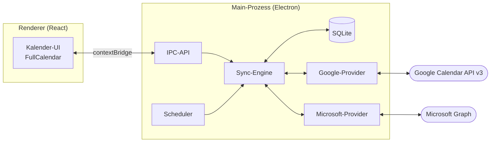
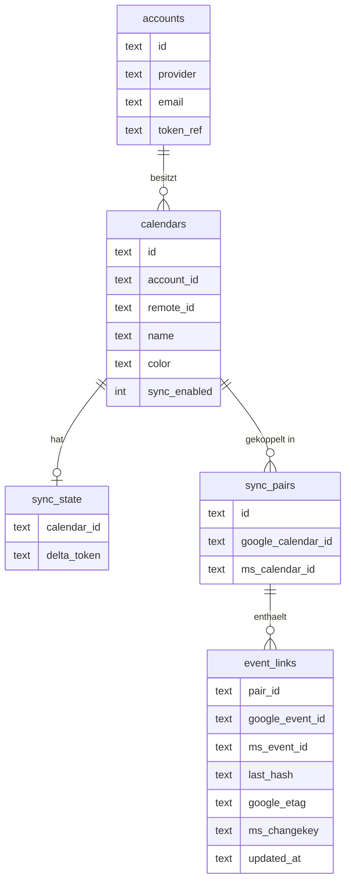

# 🏗️ Architektur

Dieses Dokument beschreibt den geplanten Aufbau der App. Es wird mit jeder Etappe an den echten Stand angepasst.

> **Stand:** Planung. Noch nichts davon ist umgesetzt.

## Überblick

Die App ist eine Electron-Anwendung mit drei Teilen:

| Teil | Aufgabe |
|---|---|
| **Main-Prozess** | Fenster, Tray, Datenbank, Anmeldung bei Google und Microsoft, Sync-Engine |
| **Preload** | Schmale, sichere Brücke (`contextBridge`) zwischen Renderer und Main-Prozess |
| **Renderer** | React-Oberfläche mit FullCalendar, Dialogen und Einstellungen |

Der Renderer spricht nie direkt mit Google oder Microsoft. Alle Zugriffe laufen über die IPC-API im Main-Prozess, dort liegen auch die Tokens.



## Projektstruktur

```
src/
  main/
    index.ts                 Electron-Start, Fenster, Tray, IPC-Registrierung
    db/schema.ts, db.ts      SQLite-Schema + Zugriff
    auth/googleAuth.ts       Loopback-OAuth, Token-Refresh
    auth/microsoftAuth.ts    MSAL interaktiv + silent, Token-Cache in safeStorage
    providers/types.ts       CalendarProvider-Interface + normalisiertes Event-Modell
    providers/google.ts      list/delta (syncToken), create/update/delete
    providers/microsoft.ts   list/delta (Graph delta), create/update/delete
    sync/engine.ts           Sync-Zyklus, Mapping, Konfliktlösung, Loop-Schutz
    sync/mapper.ts           Google ↔ normalisiert ↔ Graph (inkl. Recurrence/RRULE)
    sync/scheduler.ts        Polling (alle 2 Min. + bei Fokus + manuell)
    ipc.ts                   API für den Renderer
  preload/index.ts           contextBridge (sichere, schmale API)
  renderer/
    App.tsx, CalendarView.tsx, EventDialog.tsx, AccountsPage.tsx, SyncSettings.tsx
```

## Normalisiertes Event-Modell

Beide Anbieter werden auf ein gemeinsames Modell abgebildet:

| Feld | Bedeutung |
|---|---|
| `title` | Titel des Termins |
| `description` | Beschreibung |
| `location` | Ort |
| `start`, `end` | Beginn und Ende |
| `allDay` | Ganztägiger Termin |
| `timeZone` | Zeitzone |
| `recurrence` | Wiederholung als RRULE |
| `attendees?` | Teilnehmer (optional, wird in v1 nicht gespiegelt) |
| `status` | Status, z. B. bestätigt oder abgesagt |

Gesynct wird nur diese definierte Teilmenge an Feldern. So geht nichts verloren, nur weil ein Feld beim anderen Anbieter kein Gegenstück hat.

## Datenbank



| Tabelle | Zweck |
|---|---|
| `accounts` | Verbundene Konten mit Anbieter, E-Mail und Verweis auf das Token |
| `calendars` | Kalender eines Kontos mit Name, Farbe und ob der Sync aktiv ist |
| `sync_pairs` | Welche Kalender miteinander gekoppelt sind, z. B. Google «Privat» ↔ Outlook «Kalender» |
| `event_links` | Verknüpfung zwischen einem Google-Termin und seinem Outlook-Gegenstück, inklusive letztem Hash |
| `sync_state` | Googles `syncToken` bzw. Graphs `deltaLink` pro Kalender |

Die genauen Spalten von `sync_pairs` sind im Plan noch nicht festgelegt und werden in Etappe 1 definiert.

## Sync-Algorithmus

Der Algorithmus läuft pro Kalender-Paar.

1. **Änderungen holen.** Beide Seiten werden inkrementell abgefragt: Google über `syncToken`, Graph über `/calendarView/delta`. Beim ersten Lauf gilt ein Zeitfenster von 30 Tagen zurück bis 365 Tage voraus.
2. **Gegenstück suchen.** Für jede Änderung wird über `event_links` das Gegenstück gesucht:
   - **neu:** auf der anderen Seite erstellen und den Link speichern
   - **geändert:** Hash der normalisierten Felder mit `last_hash` vergleichen. Ist er gleich, ist es das Echo des eigenen Updates und wird ignoriert. Sonst wird die andere Seite aktualisiert.
   - **gelöscht oder abgesagt:** auf der anderen Seite löschen
3. **Konflikte lösen.** Wurden beide Seiten seit dem letzten Sync geändert, gewinnt die neuere `updated` bzw. `lastModifiedDateTime`. Das wird ins Sync-Log geschrieben.
4. **Markierung setzen.** Im Termin selbst wird eine ID-Markierung gespeichert (Google `extendedProperties.private`, Graph `singleValueExtendedProperties`). Damit werden gespiegelte Termine auch nach einem Verlust der Datenbank wiedererkannt.
5. **Fehler behandeln.**

   | Fehler | Reaktion |
   |---|---|
   | `401` | Token erneuern |
   | `410` | `syncToken` abgelaufen, Vollabgleich |
   | `429` | Backoff |

### Loop-Schutz

Schreibt die App einen Termin nach Outlook, meldet Outlook diesen beim nächsten Abruf als «geändert». Ohne Schutz würde die App ihn zurück nach Google schreiben, und so weiter. Darum wird nach jedem Schreiben der Hash der normalisierten Felder in `last_hash` gespeichert. Kommt eine Änderung mit demselben Hash zurück, ist es das eigene Echo und wird verworfen.

### Wann läuft der Sync?

- alle 2 Minuten (Polling)
- wenn das Fenster den Fokus bekommt
- manuell über die Oberfläche

## Wiederkehrende Termine

- Die Serie wird über RRULE ↔ Graph `patternedRecurrence` abgebildet: täglich, wöchentlich, monatlich, jährlich, mit Ende oder Anzahl.
- Geänderte oder abgesagte Einzeltermine einer Serie werden als Ausnahmen gesynct.
- Exotische RRULEs, die Graph nicht abbilden kann, werden als Einzeltermine gespiegelt und mit einer Warnung im Log vermerkt.

## Sicherheit

- Tokens liegen verschlüsselt im Electron `safeStorage` (Windows DPAPI), nie im Klartext in der Datenbank.
- Der Renderer hat über `contextBridge` nur Zugriff auf eine schmale, definierte API.
- Google-Anmeldung über OAuth 2.0 «Desktop app» mit Loopback-Redirect und PKCE.
- Microsoft-Anmeldung über MSAL als öffentlicher Client, Authority `common` für private Konten sowie Schul- und Firmenkonten.
